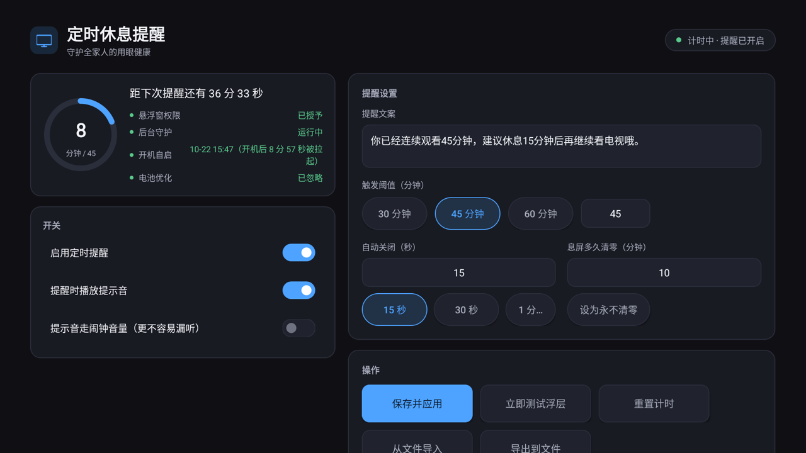

# atv-break · Android TV 定时休息提醒

[](https://github.com/scriptsmay/atv-break/actions/workflows/build-apk.yml)

电视盒子 APK：两条计时线，分别解决「一口气看太久」和「断断续续看了一整天」。

- **连续提醒**：连续亮屏到阈值（默认 **45 分钟**）在屏幕**右下角**弹浮层，10 秒自动消失；
- **每日累计**：当日累计亮屏到上限（默认 **2 小时**）弹**全屏 mask**，60 秒自动关闭，默认每 30 分钟重复一次；
- 包名：`com.atvbreak`
- 默认文案（连续）：`你已经连续观看45分钟，建议休息15分钟后再继续看电视哦。`
- 默认文案（每日）：标题 `今天已经看电视 {duration}啦` + 正文 `建议关机休息一会儿，看看远方、去户外走走～`
- 提示音：两种提醒弹出时都播放内置提示音（类似收到短信），默认开启；音量通道可选「通知音量」或「闹钟音量」
- 每日累计**按日持久化**（`daily_history`，保留 365 天），为后续统计曲线预留数据基础
- 依赖：零第三方库，只用 Android 框架 API
- 兼容：`minSdk 21`（Android 5.0+）→ `targetSdk 34`，leanback 非强制（有 TV 桌面走 LEANBACK_LAUNCHER，没有也能装）

## 界面预览

主界面（1080p TV 实机截图）：



## 一、低开销是怎么做到的

| 需求 | 实现 | 开销 |
|---|---|---|
| 不轮询 | 亮屏 / 息屏走**动态广播**（`ACTION_SCREEN_ON` / `ACTION_SCREEN_OFF`），服务内没有任何循环或定时线程 | 空闲时 0 CPU |
| 到点触发 | 交给**系统 `AlarmManager`**（`setExactAndAllowWhileIdle`），只在阈值到点那一刻唤醒一次 | 45 分钟 1 次唤醒 |
| 进程被杀也能恢复 | 计时状态写 `SharedPreferences`；**提醒闹钟由系统持有且永不取消**（息屏期间改挂不唤醒的闹钟，亮屏后系统补投），进程死了到点照样弹 | 无额外常驻线程 |
| 自愈看门狗 | 每 **15 分钟**一次 `TICK` 闹钟：对账屏幕状态、补设闹钟、发现服务心跳超时就重新拉起 | 15 分钟 1 次微唤醒 |
| 开机即计时 | `BOOT_COMPLETED` / `LOCKED_BOOT_COMPLETED` / `MY_PACKAGE_REPLACED` 拉起前台服务 | 一次性 |
| 浮层 | `WindowManager` + `TYPE_APPLICATION_OVERLAY`，`FLAG_NOT_FOCUSABLE / FLAG_NOT_TOUCHABLE` → 不吃焦点、不吃按键；`Handler.postDelayed` 到点移除 | 一次显示 10 秒 |

计时口径：**只累计亮屏时长**。息屏超过 `resetAfterScreenOffMinutes`（默认 10 分钟）视为已经休息，计时清零；触发一次提醒后开始新一轮计时。

两条线的状态完全隔离、互不干扰：

| 维度 | 连续提醒 | 每日累计 |
|---|---|---|
| 开关 | `enabled` | `enabled && dailyEnabled` |
| 计时口径 | 连续亮屏 | 当日累计亮屏 |
| 清零条件 | 触发提醒 / 息屏超 10 分钟 | 跨 00:00 |
| 默认阈值 | 45 分钟 | 120 分钟 |
| 触发后 | 清零开新一轮 | 保留累计，按间隔重复 |
| 展示 | 右下角小浮层 10 秒 | 全屏 mask 60 秒（应用前台时不弹） |

每日累计受主开关「启用定时提醒」**总闸门控**：主开关关闭时两条线一起停。

### 后台常驻与自愈

提醒链路**不依赖常驻进程**，分三层兜底：

1. **提醒闹钟由系统持有、永不取消**——即使整个进程被系统清理，到点时系统仍会把 `REMIND` 广播投递给静态注册的 `ActionReceiver`，由它拉起进程、弹浮层、续闹钟；
2. **看门狗 `TICK` 闹钟（15 分钟一次）**——对账进程死亡期间错过的亮/熄屏事件、补设闹钟、发现服务心跳超时（>30 分钟）就重新拉起前台服务；
3. **前台服务 + `stopWithTask="false"`**——退出到桌面 / 任务被划掉时服务不停止；`START_STICKY` 保证被低内存杀掉后自动重启（实测 1 秒内拉起）。

配套两件事做完，后台基本稳了：

```bash
# ① 加入电池优化白名单（install.bat 已自动做；也可在应用设置页点「加入电池优化白名单」）
adb shell dumpsys deviceidle whitelist +com.atvbreak

# ② 验证闹钟已挂载（应看到 REMIND / TICK / DAILY 三条）
adb shell dumpsys alarm | findstr atvbreak
```

注意事项：

- 设置页顶部会显示「后台守护」心跳状态，心跳超过 30 分钟没更新说明服务已死（看门狗会自动拉起）。
- **唯一救不回来的场景**：被「强制停止」（force-stop 会清掉该应用的所有闹钟）。第三方桌面 / 清理工具的「一键加速 / 清理后台」可能触发 force-stop——请在桌面或管家设置里把「定时休息提醒」加入**自启动 / 后台白名单**。
- 极端情况的自救：重启盒子（`BOOT_COMPLETED` 会重新拉起一切），或随便打开一次应用。

### 开机自启（已内置）

`BootReceiver` 监听五种开机/恢复信号，命中即拉起计时服务并重新排闹钟：

| 信号 | 覆盖场景 |
|---|---|
| `BOOT_COMPLETED` | 标准开机完成（最常见） |
| `LOCKED_BOOT_COMPLETED` | Android 7+ 未解锁状态也会发 |
| `USER_UNLOCKED` | 部分 ROM 只发这一个 |
| `QUICKBOOT_POWERON` | 部分 Amlogic / MTK 盒子的「快速开机」 |
| `MY_PACKAGE_REPLACED` | 应用升级后自动恢复计时 |

生效的两个前提：

1. **装好后至少手动启动过一次**——Android 3.1+ 新装应用处于 stopped 状态，收不到任何广播，启动一次即解除。核对：`adb shell dumpsys package com.atvbreak | findstr stopped`，应为 `stopped=false`。
2. **ROM 没有拦截第三方自启动**——部分盒子系统设置里有「自启动管理」，需要在其中放行 `com.atvbreak`。

怎么确认生效：设置页第三行会显示

- `开机自启：已生效 · MM-dd HH:mm（开机后 x 分 y 秒被拉起）`
- 或 `开机自启：尚未记录（下次开机后这里会显示时间）`

**重启盒子后打开应用看这一行即可**，不用连电脑。

免重启自检（设备有 root 时可用；`BOOT_COMPLETED` 是受保护广播，adb 默认无权发送）：

```bash
adb shell "su -c 'am broadcast -a android.intent.action.BOOT_COMPLETED -n com.atvbreak/.BootReceiver'"
adb logcat -s AtvBreak.Boot AtvBreak.Service
# 期望看到：收到 android.intent.action.BOOT_COMPLETED，启动计时服务 → 已设定提醒
```

## 二、配置方式（两种，任选）

### 1. 遥控器在设置页里改（推荐改数字）

打开应用 → 方向键移动焦点、确认键选中：

设置页分三个 tab（遥控器左右切换），底部「保存并应用 / 从文件导入 / 导出到文件」常驻，任意 tab 下都能保存：

- **总览**：计时环、权限 / 守护 / 开机 / 电池四项状态、今日累计紧凑行、三个总闸门开关、两个维护按钮
- **连续提醒**：提醒文案、触发阈值、自动关闭、息屏多久清零、`立即测试浮层`、`重置连续计时`
- **每日累计**：今日累计大数字 + 进度条 + 昨日、启用每日提醒、每日上限、全屏时长、重复间隔、`测试全屏提醒`

主开关关闭时 tab 2 / tab 3 全部置灰并提示「主开关已关闭，此处设置暂不生效」；每日开关关闭时 tab 3 的配置项置灰。

界面上改文案需要输入法，TV 上比较麻烦 → 长文案走下面的配置文件。

### 2. 改本地配置文件（推荐改文案）

配置文件路径（应用专属目录，**不需要任何存储权限**，adb 可直接读写）：

```
/sdcard/Android/data/com.atvbreak/files/config.json
```

内容（见仓库根目录 `config.example.json`）：

```json
{
  "message": "你已经连续观看45分钟，建议休息15分钟后再继续看电视哦。",
  "thresholdMinutes": 45,
  "dismissSeconds": 10,
  "resetAfterScreenOffMinutes": 10,
  "marginDp": 40,
  "enabled": true,
  "soundEnabled": true,
  "soundStream": "notification",
  "dailyEnabled": true,
  "dailyThresholdMinutes": 120,
  "dailyMaskSeconds": 60,
  "dailyRepeatMinutes": 30,
  "dailyTitle": "今天已经看电视 {duration}啦",
  "dailyMessage": "建议关机休息一会儿，看看远方、去户外走走～"
}
```

字段说明：

| 字段 | 默认 | 说明 |
|---|---|---|
| `message` | 见上 | 浮层文案 |
| `thresholdMinutes` | 45 | 连续观看多久触发 |
| `dismissSeconds` | 10 | 浮层显示多久自动关闭 |
| `resetAfterScreenOffMinutes` | 10 | 息屏超过这个时长则计时清零；设 0 表示永不清零 |
| `marginDp` | 40 | 浮层距屏幕右/下边缘的间距 |
| `enabled` | true | 总开关 |
| `soundEnabled` | true | 浮层弹出时是否播放提示音 |
| `soundStream` | `notification` | 提示音音量通道：`notification`（通知音量，像短信）或 `alarm`（闹钟音量，更不容易漏听） |
| `dailyEnabled` | true | 每日提醒开关（主开关关闭时一并停用） |
| `dailyThresholdMinutes` | 120 | 每日累计上限（分钟），范围 10–1440，越界钳制 |
| `dailyMaskSeconds` | 60 | 全屏提醒停留时长（秒），范围 10–180 |
| `dailyRepeatMinutes` | 30 | 超限后重复间隔（分钟），范围 0–240，`0` 表示当天只提醒一次 |
| `dailyTitle` | 见上 | 全屏提醒标题模板，支持 `{duration}` 占位符；**仅配置文件可改** |
| `dailyMessage` | 见上 | 全屏提醒正文；**仅配置文件可改** |

> `dailyTitle` / `dailyMessage` 不提供设置页输入框——mask 文案不像小浮层文案那样需要频繁修改。

生效方式三选一：① 点界面上的「从文件导入」；② 发广播 `adb shell am broadcast -a com.atvbreak.action.RELOAD_CONFIG -n com.atvbreak/.ActionReceiver`；③ 重启应用 / 重启盒子（文件比上次应用的时间新就会被自动加载）。

配置文件写哪个位置（两处都会被读取，谁新用谁）：

| 位置 | 适用 |
|---|---|
| `/sdcard/Android/data/com.atvbreak/files/config.json` | Android 10 及以下的盒子，或盒子上有文件管理器时 |
| 内部存储 `/data/data/com.atvbreak/files/config.json` | **Android 11+ 推荐走这里**——adb 对外部目录已无写权限，但 debug 包可用 `run-as` 写 |

写入与生效一条龙（Android 11+，需 debug 签名包）：

```bash
adb shell "run-as com.atvbreak sh -c 'cat > files/config.json'" < config.example.json
adb shell am broadcast -a com.atvbreak.action.RELOAD_CONFIG -n com.atvbreak/.ActionReceiver
```

或直接用脚本：`scripts\push-config.bat [盒子IP]`（把仓库根目录的 `config.example.json` 推进盒子并生效）。

界面上的「导出到文件」会把当前配置同时写到上述两处，拉下来改完再导回即可。

## 三、构建与安装

### 前置

| 组件 | 要求 |
|---|---|
| JDK | 17 |
| Android SDK | `platforms;android-34` + `build-tools;34.0.0` + `platform-tools` |
| Gradle | 用仓库自带 wrapper，无需本机安装 |

SDK 位置二选一：在 `local.properties` 写 `sdk.dir=<你的 SDK 路径>`（该文件不入库，换机器改这一行即可），或导出 `ANDROID_HOME` 环境变量。

Gradle 由 wrapper 从**官方源** `services.gradle.org` 拉取（仓库里不写任何镜像，这样 CI 开箱可用）。首次构建会下载约 120 MB 发行包，之后缓存在 `GRADLE_USER_HOME/wrapper/dists`，不再联网。中国大陆网络慢时，可把 `gradle/wrapper/gradle-wrapper.properties` 里的 `distributionUrl` 临时改成镜像地址——注意 wrapper **不支持环境变量插值**（它只读该文件的 `distributionUrl` 属性），所以只能改文件本身，改完别提交。

脚本需要 adb / JAVA_HOME 时，按这个顺序找：`scripts\env.bat` → 环境变量 → `PATH`。首次使用复制模板并填自己的路径：

```bat
copy scripts\env.example.bat scripts\env.bat
```

`scripts\env.bat` 已在 `.gitignore` 里——它存的是本机安装位置，属于机器本地状态，不要提交。

### 构建

```bat
:: 方式一：脚本（自动读取 JAVA_HOME / scripts\env.bat）
scripts\build.bat

:: 方式二：命令行
set JAVA_HOME=<你的 JDK 17 路径>
gradlew.bat assembleDebug
```

产物：`app\build\outputs\apk\debug\app-debug.apk`（debug 签名，可直接安装）。

### 安装到电视盒子

盒子需开启「USB 调试 / 网络 ADB」，开发机上用 `adb`：

```bash
adb connect <盒子IP>:5555
adb install -r app\build\outputs\apk\debug\app-debug.apk
```

或 `scripts\install.bat <盒子IP>`（端口默认 5555，会顺带授悬浮窗权限、加电池白名单并拉起应用）。

### 用 GitHub Actions 打包（不想配本机环境时）

流水线定义在 `.github/workflows/build-apk.yml`，只做一件事——构建 **release APK**（`assembleRelease`，复用 debug 签名，可直接安装使用）：

| 触发方式 | 产出 |
|---|---|
| Actions 页面点 **Run workflow**（手动） | 构建产物挂在本次运行的 **Artifacts** 里，需登录 GitHub 下载，默认保留 90 天 |
| 推送 tag `v*`（如 `v1.1.0`） | 额外自动创建 **GitHub Release**（**草稿态**），附上重命名为 `atv-break-<tag>.apk` 的可安装包；在 Releases 页面点 **Publish release** 才对外可见 |

不配 push / PR 自动触发——个人分支随手提交不会消耗构建机。发版由人主动打 tag，且 Release 先落成草稿：产物有问题时不会立刻对外可下载，核对无误再手动 Publish。想改为自动公开，删掉 workflow 里 `gh release create` 的 `--draft` 即可。

**CI 产物与本地产物签名不同，不能互相覆盖安装。**release 复用的是 debug 签名，而 debug keystore 是各机器在 `~/.android/debug.keystore` 自动生成的私有文件：构建机上没有时会现生成一个新的。实测两边 20 个条目里只有 `META-INF/*`（签名）和 git 信息不同，代码与资源逐条 CRC 相同，但签名身份不同，因此把 CI 的包覆盖装到已装本机包的设备上会报 `INSTALL_FAILED_UPDATE_INCOMPATIBLE`，只能先卸载（卸载会清掉配置与计时状态）。要么固定用同一个来源安装，要么把正式 keystore 存进 Actions Secrets 并写进 `signingConfig`。

## 四、首次运行的必做一步：授予悬浮窗权限

浮层依赖 `SYSTEM_ALERT_WINDOW`。两个途径：

1. 打开应用 → 若显示「悬浮窗权限：未授予」，点「去授权悬浮窗」按钮（部分精简 ROM 没有对应设置页，会提示走 adb）。
2. adb 直接授权（**推荐，最稳**）：

```bash
adb shell appops set com.atvbreak SYSTEM_ALERT_WINDOW allow
```

验证：`adb shell appops get com.atvbreak SYSTEM_ALERT_WINDOW` 返回 `allow`。

## 五、验收清单

```bash
# 1）拉起服务并看状态
adb shell am start -n com.atvbreak/.MainActivity
adb logcat -s AtvBreak.Service AtvBreak.Overlay AtvBreak.Config AtvBreak.Action

# 2）立刻看浮层效果（不等待 45 分钟）
adb shell am broadcast -a com.atvbreak.action.TEST_REMINDER -n com.atvbreak/.ActionReceiver

# 3）把阈值改成 1 分钟，等 60 秒看是否自动弹出并按时消失
adb shell "run-as com.atvbreak sh -c 'cat > files/config.json'" < config.example.json
adb shell am broadcast -a com.atvbreak.action.RELOAD_CONFIG -n com.atvbreak/.ActionReceiver
adb shell am broadcast -a com.atvbreak.action.RESET_TIMER    -n com.atvbreak/.ActionReceiver

# 4）抗清理测试：强杀进程，应在 1 秒内被 START_STICKY 拉起，且到点提醒不丢（需 root）
adb shell "su -c 'kill -9 $(pidof com.atvbreak)'"
adb logcat -s AtvBreak.Service AtvBreak.Action | grep -E "has died|Scheduling restart|触发提醒"

# 5）每日全屏提醒立即测试（不写已提醒标记、不改变累计）
adb shell am broadcast -a com.atvbreak.action.TEST_DAILY_MASK -n com.atvbreak/.ActionReceiver

# 6）跨天切分测试（debug：注入当前墙钟，不必真等到午夜）
adb shell am broadcast -a com.atvbreak.action.DAILY_ROLL_DAY --es day 2026-10-30     -n com.atvbreak/.ActionReceiver

# 7）核对三条闹钟（REMIND / TICK / DAILY）
adb shell dumpsys alarm | grep atvbreak

# 8）读取当日累计、历史与已提醒标记（debug 包）
adb shell run-as com.atvbreak cat shared_prefs/atv_break.xml

# 9）快速验证：把每日上限改成 2 分钟、全屏 15 秒、每 1 分钟重复
adb shell "run-as com.atvbreak sh -c 'cat > files/config.json'" <<'EOF'
{"dailyThresholdMinutes":2,"dailyMaskSeconds":15,"dailyRepeatMinutes":1}
EOF
adb shell am broadcast -a com.atvbreak.action.RELOAD_CONFIG -n com.atvbreak/.ActionReceiver
```

每日线的验收要点：

- 阈值设 2 分钟：累计亮屏到点后 5 秒内弹全屏 mask，到时长自动消失，提示音可闻；
- 重复间隔设 0 后当天不再弹；设 30 分钟后按间隔再弹；
- 应用内关闭「每日提醒」：当前 mask 立即收起、后续不再弹、`dumpsys alarm` 中 DAILY 消失；
- 关闭主开关：DAILY 闹钟同样消失，两条线一起停；
- 息屏期间不累计、不弹出；息屏到点后亮屏能补弹；
- 跨天切分：23:40 亮屏、00:30 息屏 → 今日 30 分钟、昨日 20 分钟；
- 连续两天未开机后打开，昨日显示 `—`（不是 0，也不是几天前的数）；
- 历史落盘：跨天后 `daily_history` 中前一日数值与界面一致；息屏后当日值已写入；
- 应用在前台时不弹 mask，tab 1 状态点变橙；退出应用后能补弹；
- 提醒仲裁：连续提醒与 mask 同时成立时只出现 mask、只有一路提示音。

实测基线（Android 11 / API 30、1080p 盒子）：安装、设置页遥控器导航、浮层右下角弹出与自动关闭、1 分钟阈值按点触发（误差秒级）、配置文件热导入、`deviceidle whitelist` 生效、REMIND + TICK 双闹钟挂载、强杀后自重启且提醒不丢；浮层在全屏视频播放器（如 SmartTube）之上正常显示。

**未覆盖**：DRM L1（`isSecure=true`）内容——安全视频层有可能反盖浮层，待验证。

兼容性检查点：

- 系统版本：`adb shell getprop ro.build.version.sdk`（≥21 即可）
- 分辨率适配：浮层宽度取屏幕 42%，1080p / 4K 均在右下角
- 遥控器导航：设置页所有控件可上下左右到达；浮层弹出时焦点不被抢走
- 息屏/亮屏：`adb shell input keyevent KEYCODE_POWER` 两次，日志应出现「息屏，暂停计时」

### 浮层能不能盖住别的 App

能。`TYPE_APPLICATION_OVERLAY` 的层级高于所有应用窗口，已在全屏视频播放中实测叠加成功。
判据按可靠性排序：

1. **肉眼**——对 DRM 内容也成立的唯一判据；
2. `dumpsys window | grep "Window #"` 看合成顺序，浮层应排在目标应用 Activity 之后；
3. `dumpsys SurfaceFlinger | grep -iE "isSecure|SurfaceView"` 看视频层是不是安全层。

两个取证坑：

- **播放态别拿截图当证据**：有硬件视频层在播时 `screencap` 返回同一张黑帧，浮层不进采集；桌面与非播放态截图才可靠。
- **先把 `dismissSeconds` 临时调到 60 再弹**：10 秒窗口来不及跑完上面三条 dump。

## 六、代码结构

```
app/src/main/java/com/atvbreak/
├── AppConfig.java        配置：默认值 + SharedPreferences + JSON 文件导入导出（内/外两处）
├── MainActivity.java     TV 设置界面（遥控器可操作：三 tab + 常驻底部操作栏）
├── TimerRingView.java    状态卡环形进度（自绘 View，连续观看时长 / 阈值）
├── DurationFormat.java   时长格式化（设置页与全屏 mask 共用）
├── DailyWatchStats.java  每日累计状态机 + 按日落盘（daily_history，保留 365 天）
├── WatchTimerService.java 计时前台服务（事件驱动 + AlarmManager + 15 分钟看门狗自愈）
├── ActionReceiver.java   指令入口（系统到点提醒 / 每日到点 / adb 调试广播）
├── ReminderOverlay.java  右下角浮层（自动关闭，弹出时按配置播放提示音）
├── DailyMaskOverlay.java 每日累计全屏 mask（不可聚焦、自动关闭、5% overscan 边距）
├── ReminderSound.java    提示音播放（内置 res/raw/reminder_chime.ogg，可选通知/闹钟音量通道）
└── BootReceiver.java     开机 / 解锁 / 快速开机 / 升级后拉起服务（并记录自启时间）
```

本地单元测试（`app/src/test/java/`，不进 APK）：

```bash
./gradlew testDebugUnitTest
```

脚本：

| 脚本 | 用途 |
|---|---|
| `scripts\build.bat` | 构建 debug APK |
| `scripts\install.bat [IP]` | 安装到盒子并自动授浮层权限、加电池白名单、启动应用 |
| `scripts\test-reminder.bat [IP]` | 立即弹一次浮层 |
| `scripts\push-config.bat [IP]` | 推送 `config.example.json` 到盒子并热生效 |
| `scripts\_env.bat` | 内部：解析本机 JDK / SDK / adb 路径 |

## 七、已知取舍

- 提醒一次后**自动开始下一轮计时**，不做「必须休息满 15 分钟才重置」的强制；真休息（息屏）超过 `resetAfterScreenOffMinutes` 才会清零。要更强的强制逻辑，改 `WatchTimerService.fireReminder()`。
- 常驻的是一个 `IMPORTANCE_MIN` 的前台服务通知（Android 8+ 常驻必需），在通知栏里几乎不可见——这是「感觉程序没了」的主要原因，实际以设置页「后台守护」状态为准。
- 进程死亡期间的亮屏时长无法精确补计（看门狗策略偏保守：宁可少算不乱算），最坏情况是某次提醒晚几分钟。
- 部分盒子 ROM 的遥控器电源键长按是**完整关机**而非待机：正在计的这一轮会被清零，网络 adb 也一并掉线（容易被误判成「没弹」）。下次开机 `BootReceiver` 会重新拉起并重新计时，所以「开机后 45 分钟提醒」这一层不受影响。
- 未做正式签名与多渠道配置——面向局域网内 adb 自装，release 构建直接复用 debug 签名；要上应用市场需自行配置签名与 leanback 声明。
- **全屏 mask 不抢焦点**：`FLAG_NOT_FOCUSABLE` 的代价是遥控器按键仍会传给底层应用，用户切台 / 换应用 / 按主页键即可绕过。mask 是视觉阻断，不构成强制拦截。
- **两条线都只认亮屏**：暂停播放但屏幕亮着的时间同样计入。要按「实际播放」统计需要 `UsageStatsManager` 特殊权限，收益低，未做。
- **DRM 播放器兼容性**：部分 DRM 内容（`isSecure=true`）可能反盖 overlay 或导致降级，自用场景影响小。
- **数据保留**：每日累计按日保存在 `atv_break` prefs 的 `daily_history` 中，保留 365 天（稳态约 8 KB），随 `allowBackup=true` 一并备份。
- **重启口径**：重启瞬间的亮屏段不补计（与连续计时一致），当日累计保留。

## 八、许可

Copyright (C) 2026 scriptsmay

本程序在 **GNU 通用公共许可证 v3.0**（或后续版本）条款下发布，详见 `LICENSE`。
浮层文案、图标等素材随代码一并按 GPL-3.0 授权。
